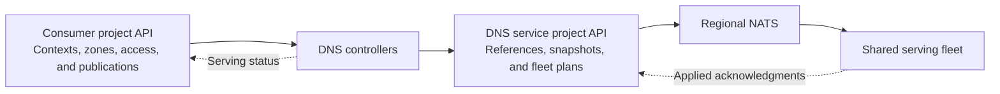
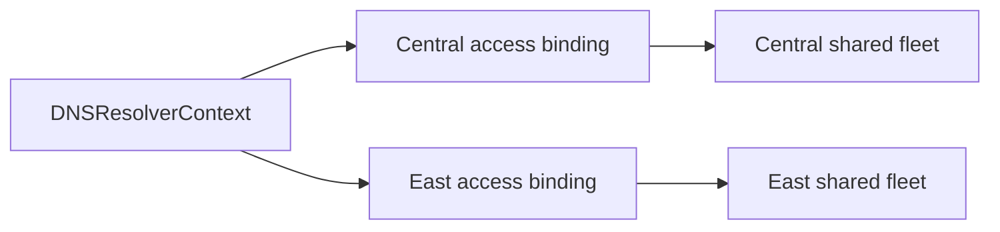
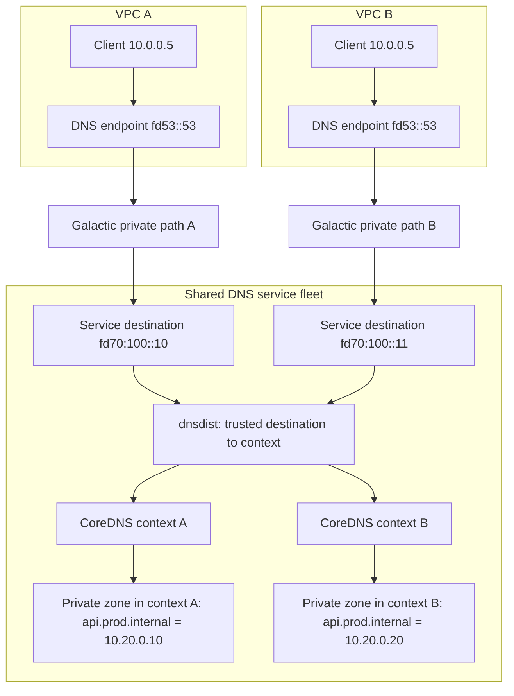
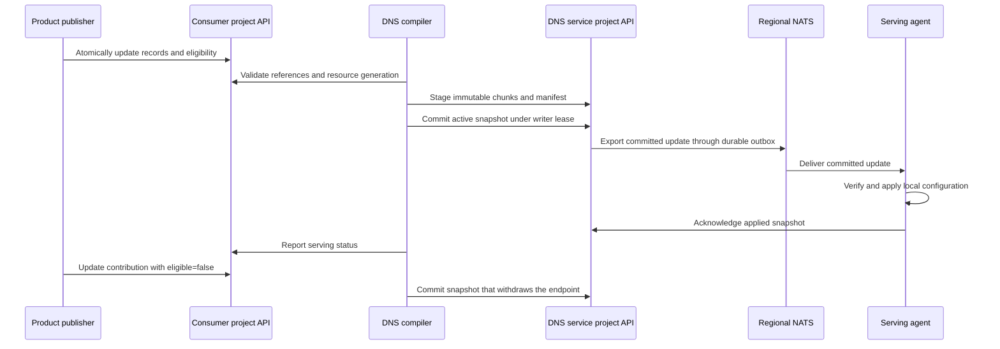

# Internal DNS architecture

- [Summary](#summary)
- [Motivation](#motivation)
  - [Goals](#goals)
  - [Non-Goals](#non-goals)
- [Proposal](#proposal)
  - [Risks and mitigations](#risks-and-mitigations)
- [Design Details](#design-details)
  - [Control-plane boundaries](#control-plane-boundaries)
  - [Contexts and regional access](#contexts-and-regional-access)
  - [Query path and network identity](#query-path-and-network-identity)
  - [Threat model](#threat-model)
  - [Publication and service discovery](#publication-and-service-discovery)
  - [API design](#api-design)
  - [Integration boundaries](#integration-boundaries)
- [Production Readiness Review Questionnaire](#production-readiness-review-questionnaire)
- [Implementation History](#implementation-history)
- [Drawbacks](#drawbacks)
- [Alternatives](#alternatives)
- [Infrastructure Needed](#infrastructure-needed)

## Summary

Internal DNS lets resources resolve private names within a VPC. Each network has
a managed namespace and can use additional private zones. Product services
publish names automatically, and shared regional fleets serve many VPCs with
isolated DNS contexts.

The [product enhancement](https://github.com/datum-cloud/enhancements/pull/922)
defines the consumer experience. The
[Galactic design](https://github.com/datum-cloud/galactic/blob/main/docs/enhancements/networking/private-service-connect/README.md)
defines private connectivity. This enhancement defines the DNS architecture and
[API design](#api-design).

## Motivation

Resources need private names without a zone choice on every resource. The
platform must isolate overlapping names and addresses across networks and
withdraw endpoints that are no longer eligible.

### Goals

- Serve private zones through the VPC's inherited resolver configuration.
- Allocate default names and support additional custom zones.
- Isolate overlapping names, addresses, and resolver caches across DNS contexts.
- Accept publications from distributed product control planes and withdraw
  endpoints after an explicit health update or deletion.
- Keep serving applied DNS configuration during control plane outages.
- Scale shared serving capacity across regions without deployments per VPC.

### Non-Goals

- Designing Galactic's private connectivity APIs or packet handling.
- Having DNS controllers inspect networking or product resources.
- Defining application health policies for product services.
- Changing public DNS behavior or defining cross-project zone sharing.

## Proposal

Network services selects the default VPC domain, `datum.internal`, and provisions
a DNS context and regional resolver access. DNS allocates the requested managed
namespace, accepts explicit custom zone associations,
and compiles product publications into private serving state. Consumers use a
stable resolver address in their VPC while the platform selects shared capacity.

DNS APIs reference resolver contexts and zones. Network services owns the mapping
from a network to its DNS context and the consumer-facing resolver address. DNS
reserves service-side listener addresses and accepts registrations from any
authorized publisher; naming rules match registration labels.

### Risks and mitigations

- Tenant leakage: authorize network identity before cache lookup, isolate
  DNS contexts, and test overlapping zones and forged identities.
- Delayed health updates: retain the last reported endpoint state during outages
  and reconcile changes when connectivity returns.
- Tenant identity reuse: retain destination allocations until withdrawal is
  confirmed across the serving fleet.
- Shared fleet failure: qualify configuration activation, readiness, capacity,
  and regional failure handling before release.

## Design Details

### Control-plane boundaries

The DNS service separates project intent from shared regional serving state.
The [product enhancement](https://github.com/datum-cloud/enhancements/pull/922)
covers platform placement; Galactic owns private connectivity and network identity.



Trusted network integration writes context and access intent. Product services
write registrations and contributions. DNS controllers compile that intent and
report whether the serving fleet has applied it. Karmada distributes workloads
and network configuration; it does not carry DNS record updates.

DNS discovers ready Milo projects and watches every namespace through
authenticated project clients. Discovery outages retain existing sources and
applied serving state. Admission uses the authenticated project parent identity
for live reference validation. VPC integration and product publishers translate
their resources into DNS intent; DNS does not watch their APIs.

### Contexts and regional access

A logical network has one DNS context across its locations. The context selects
its managed namespace and associated zones. Separate contexts can use identical
zone names and overlapping IP addresses. Sharing a zone requires an explicit
association within the project. Network peering does not automatically share
zones or extend DNS access; cross-project sharing is outside this proposal.



Bindings live in the consumer project API; `region` selects serving capacity.
Each has independent identity, access mapping, and readiness. Publication is
asynchronous, and a failed region must not block healthy regions. Regional access
does not imply that discovery returns only region-local endpoints. The VPC
resolver handles both private and public queries, so loss of every eligible
member in its region interrupts both. This design does not provide automatic
cross-region resolver failover.

### Query path and network identity

Both VPCs can expose the same DNS address and contain the same client IP. Galactic
authorizes the private path and translates its destination into a distinct
service-side identity. DNS maps that identity to a context before consulting a
cache or selecting private zones.



Galactic verifies the source VPC lifetime and route authorization before
translating the destination. DNS trusts that path, not client addresses, ECS, or
client-supplied PROXY headers. Consumers cannot select another context by
addressing its service-side destination.

Shared node and regional tiers use:

1. **dnsdist** to select the context before lookup, with private packet caching
   disabled.
2. **CoreDNS with a context plugin** to select private zones from the trusted
   destination. Node members forward to the context's regional destination;
   regional members answer private queries from accepted publication snapshots.
3. **PowerDNS Recursor** to resolve public names. CoreDNS keeps public caches
   separate by context and bypasses caching for private names.

[dnsdist PROXYv2](https://www.dnsdist.org/advanced/passing-source-address.html)
preserves the destination. The CoreDNS transport adapter accepts PROXYv2 only
from configured service peers over TCP. dnsdist forwards both consumer UDP and
TCP queries over this protected TCP backend; CoreDNS has no UDP listener.
Unknown contexts are rejected before record or cache lookup.

The publication agent validates and persists a complete snapshot. The context
plugin builds a replacement lookup table, then atomically activates it without
restarting DNS listeners. Invalid updates retain the accepted table. Persistent
snapshots allow serving to recover without an available control plane or broker.
A shared member must prove the current configuration and publication before it
receives traffic for that context.

### Threat model

DNS does not authenticate callers itself. The project API server authenticates
every request and authorizes it with RBAC before DNS admission or controllers
see the object. Only principals bound to the `internal-dns-vpc-integration` role
can write `DNSResolverContext` and `DNSResolverAccessBinding`; bind that role
only to the network integration's service principal in each project. Customer
roles (`dns-admin`, `internal-dns-customer`) and the product publisher role
(`internal-dns-product-writer`) cannot create either resource. The DNS admission
webhook does not inspect the caller; it validates live references and lifetimes.

DNS does not rely on RBAC alone. If a principal writes a context or access
binding it should not, DNS fails closed:

- Destination takeover: DNS records each destination claim per region with the
  owning project and context. A binding for a destination that another project
  or context holds reports `Accepted=False` with reason `InvalidOrStaleAccess`
  and is never mapped to a context.
- Forged `consumerID`: DNS does not dereference `consumerID` or use it for
  authorization. Ownership is the authenticated project and the context UID, so
  a copied value grants nothing. A second live context in the same project
  namespace with the same `consumerID` reports `DuplicateConsumerID`.
- Replaced objects: access bindings pin the context UID. A binding whose context
  was deleted and recreated with the same name is rejected.
- Forged network identity: DNS ignores client addresses, ECS, and
  client-supplied PROXY headers. CoreDNS accepts PROXYv2 only from configured
  peers over TCP.

Galactic decides which service-side destination each VPC can reach. A
destination claim in DNS does not route another VPC's traffic to it.

### Publication and service discovery

A registration reserves a name and record types in one zone. Names have no
automatic product prefix or generated suffix. An RBAC-authorized product service
publishes records and explicit endpoint eligibility through a contribution. DNS
validates ownership and resource generations, then compiles a zone snapshot.

DNS does not rank publishers. A Compute instance, a Connect export, and a
customer registration that claim the same name compete under one rule:

1. Static records in the zone claim their names first.
2. Among registrations, the oldest by creation time wins; the UID breaks ties.
3. A claim conflicts with another claim for the same name and record type. A
   CNAME conflicts with every other type at that name, so registrations for
   different non-CNAME types at one name can both be accepted.

A losing registration reports `Accepted=False` with reason `NameConflict` and
publishes nothing. DNS does not rename it or add a suffix; the publisher picks
another name. When the winning claim is deleted, the next oldest registration
is accepted on the next compilation.



Each zone has one compiler owner, fenced by a compare-and-swap lease. Takeover
advances the writer epoch; revisions increase within it. Agents reject older
versions. The compiler stages immutable chunks and a manifest, then commits its
active pointer. This state and a durable outbox live in platform Kubernetes API
storage by default; exporters repair missing outboxes after crashes.

The `publicationStore` option keeps the same records (ownership leases,
manifests, chunks, outboxes and shard ownership) in a JetStream key-value bucket
instead, so publishing does not wait on the platform API server. Resource
versions are bucket revisions, so every lease, commit and status write keeps its
compare-and-swap fence. A writer that creates or takes over a lease takes an
epoch of at least the current Unix time, so a new or lost store never leaves
agents fencing out the new writer. A publication is deleted ten minutes after a
newer one of its zone was exported, unless a pending outbox depends on it.
Tenant objects, resolver bindings, address claims and tenant status stay in the
API server.

The bucket exists on every region's broker. Shard leases and serving snapshots
live on the broker of the region they serve, and each region's planner, outbox
and acknowledgement loops look records up only in that region's bucket and the
home bucket, so another region's broker never holds them up. Zone leases,
manifests, chunks and their outboxes live together on the broker of
`publicationStore.region`, so committing a zone needs only that broker, and
delivering it to any region also needs that broker, until zone publication has
one writer per zone and region. Regions that share a
broker must name it with the same URL. Cleanup waits until every region's
bucket has loaded.

Leases live in the store, so every control-plane replica must use the same one.
A ConfigMap named `internal-dns-publication-store` records the active store, and
a replica configured for another store refuses to start. To switch, stop every
replica, set the ConfigMap's `data.store` to `jetstream` or `kubernetes`, then
start the replicas with the new setting. Alternatively, set
`switchPublicationStore` in a rollout that stops every replica before starting
new ones, such as a Deployment with the `Recreate` strategy; the first new
replica then records its store as the active one. A first start on JetStream with no
ConfigMap refuses to run while publication records exist in the API server.
Once writer epochs follow the clock, downgrading to a release that counts
epochs from one is not supported.

#### A control plane per region

The `regions` option runs one control plane per region, so a region keeps
publishing while another region, its broker or its control plane is down. Each
control plane lists every region's shards, so a context gets the same shard
assignment everywhere, but it plans, publishes and acknowledges only its own
regions and connects only to their brokers. Its publication store lives on its
own region's broker, and the bucket records which regions own it, so a control
plane for other regions refuses to start on it.

Each region's control plane holds its own lease for every zone, compiles the
zone and commits a manifest with only its own serving targets. Writer epochs
and revisions are ordered within a region; members only see their own region's.
A manifest also names every region the zone is served in, so project status can
wait for all of them: zones, registrations and contributions report each
region's publication in `status.regions`, and `Published` names the regions
still pending instead of one region's outage hiding the others' progress.
Access bindings, resolver bindings and destination claims are handled by the
control plane of the binding's region; access in a region no control plane
serves is rejected by all of them. Before a region first publishes a zone, it
adds a finalizer for every region the zone is served in, so a zone is not
removed while any region still serves it, even one whose control plane is
down. Each region removes its own finalizer once it has withdrawn the zone. A
region taken out of service leaves its finalizers on zones it served, and they
must be removed by hand.

The project API stays shared: every region reads its inputs from it and writes
status to it. Moving to regional control planes uses the stopped rollout above,
with `data.store` set to `jetstream-regional`; serving members keep answering
from their checkpoints during the switch, and each region's first writer epoch
is above the shared writer's. Serving outboxes for other regions left in a
region's bucket by the shared writer are collected. Until each region first
compiles a zone, its project status may briefly read not published, and a
zone deleted in that window is withdrawn from a region that has not compiled it
yet only when its resolver bindings drop the zone. Switching back to a control
plane for every region is not supported.

Contexts, access bindings, and publications share one stable shard assignment
per region. Capacity limits admit established contexts before new allocations.
New allocations that exceed capacity report a condition. If an update cannot
retain established access, the planner rejects the update and retains the
applied configuration. Destination ownership follows the context
lifetime, so recreating its access binding can retain the same destination.

Regional agents render committed snapshots as zone files, validate and activate
them in the associated CoreDNS contexts, then acknowledge serving.

Regional [NATS JetStream](https://docs.nats.io/nats-concepts/jetstream) delivery is
at least once. Every serving replica receives its complete assignment and
acknowledges applied state separately from broker receipt. Queries use local
state without contacting project APIs or the broker.

Products define eligibility for instance identity, application discovery, or
stable service addresses. Records and resolver bindings persist until an explicit
update or withdrawal. Control plane and messaging outages delay changes but do
not expire applied DNS configuration. Agents can restore verified configuration
from local checkpoints without contacting the control plane. A restarted agent
serves its restored checkpoint for at most 15 minutes without receiving DNS
state, then gates serving until state arrives. An endpoint can
remain published indefinitely if its publisher cannot report a health change.
This availability tradeoff is intentional; record TTLs bound client caching,
not the lifetime of authoritative records.

Agents retain desired version fences and an activated configuration separately.
A rejected expansion retains that configuration; a rejected withdrawal gates
serving. Healthy DNS continues through normal agent stops and restarts.
Readiness verifies durable activation state, the active checkpoint, and local
consumer listeners over UDP and TCP and CoreDNS over TCP, without contacting
the broker or project APIs. A SERVFAIL answer is not ready. A routine
installation held by a live agent's transaction lock stays ready while the
daemons answer, for up to one minute.
The serving supervisor retains approved configuration independently of the
agent. A transaction lock owns candidate verification; incomplete or orphaned
activation stays gated until recovery verifies the saved configuration. DNS query probes and backend health checks isolate
serving failures from update delivery. Retained tombstones and writer fences
prevent replay from restoring withdrawn records or access. A new serving node
requires a complete configuration before accepting queries.

A reserved name without eligible addresses returns NODATA. A pending private zone returns SERVFAIL only beneath its own apex; other zones
and public recursion continue. Missing required
private state returns SERVFAIL; unknown or withdrawn access returns REFUSED.
Private names never fall back to public resolution. Disable stale private
answers and bound dynamic TTLs; withdrawal budgets include client caching.

### API design

All examples use `dns.networking.miloapis.com/v1alpha1`. The project API assigns
object UIDs and generations. Reference identities and addresses below are
illustrative. `status` examples show controller output and
are not fields consumers submit when creating resources.

#### Ownership and validation

Customers select zones and contexts by name within their project namespace. DNS
resolves these references and stores ownership identities in internal reference
records in the DNS service project. Project status exposes names and conditions.
Internal publication and access contracts pin UIDs and policy generations.
The project API server authenticates callers and uses RBAC to authorize resource
and status operations. Separate roles govern product publication, network integration, and DNS
controllers. Product services are trusted within their project permissions.
Admission validates live references; DNS checks name conflicts and record scope.

#### Context and regional access

Network services creates an opaque DNS scope and requests its managed domain.
DNS does not dereference the `consumerID` or watch a networking resource. Other
trusted integrations can request a different domain through the same contract.

```yaml
apiVersion: dns.networking.miloapis.com/v1alpha1
kind: DNSResolverContext
metadata:
  name: application
spec:
  # Immutable lifetime identity supplied by trusted VPC integration.
  consumerID: "11111111-1111-4111-8111-111111111111/22222222-2222-4222-8222-222222222222"
  # Allocate a default private namespace without asking users to choose a zone.
  managedNamespace:
    enabled: true
    # Consumer integration policy selects the apex; it is immutable in this context.
    domainSuffix: datum.internal
status:
  # DNS-owned output; publishers use this allocated zone and suffix.
  managedNamespace:
    dnsZoneRef:
      name: managed-application
    suffix: datum.internal
  # Regional assignments do not move this object out of the project API.
  servingTargets:
    - region: us-central-1
      shard: shared-0
---
apiVersion: dns.networking.miloapis.com/v1alpha1
kind: DNSResolverAccessBinding
metadata:
  name: application-us-central-1
spec:
  # Pin the context lifetime so recreation cannot inherit old access.
  contextRef:
    name: application
    uid: 33333333-3333-4333-8333-333333333333
  # Select the serving region, not a separate project control plane.
  region: us-central-1
  # Spec, written by trusted network integration. DNS reserves it before
  # accepting access; Galactic maps verified VPC traffic here.
  # It differs from the well-known address exposed inside the VPC.
  destinationAddress: fd70:100::10
```

`destinationAddress` is a spec field. The trusted network integration writes it,
and DNS neither allocates nor rewrites it. DNS reserves the address when it
accepts the binding and reports the result in status conditions.

Access reports `Accepted` after validation and `Ready` after required members
apply the current access mapping and configuration. Zone publication readiness is
reported separately; a pending zone does not block resolver access. Context, region,
and destination are immutable per access lifetime. dnsdist serves consumers over
UDP and TCP on port 53, and DNS generates internal mapping versions. DNS reserves
each destination per region across all projects and rejects conflicting
ownership. Serving rejects ambiguous mappings before lookup. Galactic enforces
network access to each destination. The [threat model](#threat-model) describes
who can create contexts and access bindings and how DNS fails closed.

#### Private zones and associations

Users can add a custom zone to the context and create static records in it.
Private zones do not require public domain verification or public delegation.

```yaml
apiVersion: dns.networking.miloapis.com/v1alpha1
kind: DNSZone
metadata:
  name: production
spec:
  # Visibility is immutable. The existing default remains Public.
  visibility: Private
  # Different contexts can associate separate zones with this same apex.
  domainName: prod.internal
  # Select private backend policy; users do not choose fleet instances.
  dnsZoneClassName: datum-internal-dns
---
apiVersion: dns.networking.miloapis.com/v1alpha1
kind: DNSZoneAssociation
metadata:
  name: production-application
spec:
  # Select the zone by name within this project namespace.
  dnsZoneRef:
    name: production
  # DNS consumes a context reference, not a VPC reference.
  resolverContextRef:
    name: application
---
apiVersion: dns.networking.miloapis.com/v1alpha1
kind: DNSRecordSet
metadata:
  name: database
spec:
  # Existing record API: a same-project name reference to its zone.
  dnsZoneRef:
    name: production
  recordType: A
  records:
    # Static records have no endpoint eligibility lease.
    - name: database
      ttl: 30
      a:
        content: 10.20.0.50
```

DNS pins each association's resolved zone and context lifetimes. A replacement
with the same name does not inherit the association; recreate the association
to attach it. Customers cannot change the resolved identities in status.

A context can use several zones. Reject duplicate apexes within a context and
conflicts between static records and reserved names. Select parent and child
zones by longest suffix. Separate contexts can explicitly share a zone or use
independent zones with the same apex. Static records have no health lease.

#### Automatic naming and additional names

The context directly owns its managed zone and association. DNS allocates the
requested zone and exposes its reference and suffix in context status. Product publishers use these outputs. A naming policy
adds custom names without a zone choice on each Compute or Connect resource.

```yaml
apiVersion: dns.networking.miloapis.com/v1alpha1
kind: DNSNamingPolicy
metadata:
  name: application-production-names
spec:
  # Apply naming rules to this DNS scope.
  resolverContextRef:
    name: application
  additionalNames:
    # Match DNS registration labels from any authorized publisher.
    - selector:
        matchLabels:
          app: storefront
      dnsZoneRef:
        name: production
      namePrefix: storefront
    # An omitted selector adds this name for every registration in the context.
    - dnsZoneRef:
        name: production
      namePrefix: services
```

Every target zone must be associated with the context. DNS retains the policy's
resolved lifetimes; recreate the policy to use a replacement zone or context
with the same name. Selectors match `DNSRegistration.metadata.labels` using
`matchLabels` or `matchExpressions`. An omitted or empty selector matches every
registration in the context. Matching rules add
`<allocated-name>.<namePrefix>.<zone-domain>`; overlapping rules produce one
reservation per zone and name. Product integrations apply the accepted rules
when reserving additional names. Project RBAC authorizes publication.

#### Product publication

Compute reserves names in the managed namespace and publishes eligible interface
addresses. Connect uses the same contribution API with its export eligibility
policy. Each service authenticates to the project API with scoped RBAC access.

```yaml
apiVersion: dns.networking.miloapis.com/v1alpha1
kind: DNSRegistration
metadata:
  name: instance-web-01
  # Naming policies match these generic registration labels.
  labels:
    app: storefront
spec:
  # Select the managed zone allocated for the resource's DNS context.
  dnsZoneRef:
    name: managed-application
  # Reserve this relative owner name, rather than one particular IP address.
  name: web-01
  # Constrain which record types contributions can populate.
  recordTypes: [A, AAAA]
  # Bound client caching after a record update or withdrawal.
  ttlSeconds: 30
  # Optional descendant reservations must not overlap other owners.
  reservedDescendants: []
status:
  # DNS-owned output for product status and consumer display.
  canonicalFQDN: web-01.datum.internal
---
apiVersion: dns.networking.miloapis.com/v1alpha1
kind: DNSRecordContribution
metadata:
  name: web-01-endpoint
spec:
  # Bind the contribution to the reserved name and its current policy.
  registrationRef:
    name: instance-web-01
    uid: 55555555-5555-4555-8555-555555555555
    generation: 1
  # Publish eligibility and addresses together in one desired-state update.
  eligible: true
  # Product policy determines eligibility for this name's purpose.
  reason: NetworkInterfaceProgrammed
  # Reuse the existing typed record representation.
  recordSets:
    - recordType: A
      records:
        - name: web-01
          ttl: 30
          a:
            content: 10.20.0.10
    - recordType: AAAA
      records:
        - name: web-01
          ttl: 30
          aaaa:
            content: fd20::10
status:
  # DNS-owned: the desired generation processed by DNS.
  observedGeneration: 1
  # DNS-owned: the publication revision that included this contribution.
  publishedRevision: 12
```

Publishers update records and eligibility atomically with optimistic concurrency.
An explicit update with `eligible: false` withdraws the endpoint; recovery sets it
to true. Kubernetes assigns a new generation to each desired-state change. DNS
retains UID and generation fences across controller takeover and replay. Status
belongs to DNS. Publisher unavailability leaves the last desired state in place.
The compiler rejects stale generations and records outside the registration.

#### DNS service project contracts

These resources are internal to the DNS service project. Consumers and product
publishers cannot write them. Examples show selected fields that explain
coordination; they are not complete generated serving plans or transport payloads.

The proposed `DNSResolverBinding` groups four concerns: source identity,
regional placement, generated serving configuration, and access versions.
It binds a consumer DNS context to shared capacity; it does not describe a VPC
or create a resolver deployment.

```yaml
apiVersion: dns.networking.miloapis.com/v1alpha1
kind: DNSResolverBinding
metadata:
  name: application-us-central-1
  namespace: dns-platform
spec:
  source:
    # Scope source references to the authenticated consumer project.
    projectUID: 11111111-1111-4111-8111-111111111111
    # Pin the DNS context lifetime; DNS does not dereference a VPC.
    resolverContextRef:
      name: application
      uid: 33333333-3333-4333-8333-333333333333
    # Identify the regional access mapping that produced this plan.
    accessBindingRef:
      name: application-us-central-1
      uid: aaaaaaaa-aaaa-4aaa-8aaa-aaaaaaaaaaaa
  placement:
    # Identify shared capacity; these fields do not select the source API.
    region: us-central-1
    shard: shared-0
  configuration:
    # Fence plan replacement. This is distinct from metadata.generation.
    generation: 1
    # Order configuration changes within this plan generation.
    revision: 7
    query:
      # Galactic maps the consumer resolver address to this context destination.
      nodeAddress: fd70:100::10
      # Node resolvers forward to this regional context destination.
      regionalAddress: fd70:200::10
    # Reserve private apices even while their publication is pending.
    zoneApices:
      44444444-4444-4444-8444-444444444444: datum.internal
      88888888-8888-4888-8888-888888888888: production.internal
    zoneRefs:
      # Include only private zones explicitly associated with the source context.
      - name: managed-application
        uid: 44444444-4444-4444-8444-444444444444
      - name: production
        uid: 88888888-8888-4888-8888-888888888888
  version:
    # DNS generates ordering fences for this mapping's lifetime.
    epoch: 3
    sequence: 27
```

Source and zone references resolve in `source.projectUID`, not the DNS service
namespace. Source identity is immutable. The region and node listener match the
access binding; DNS allocates the regional listener.

Configuration generation fences plan replacement; revision orders its updates.
DNS generates private access versions and advances them for withdrawal and recovery. Serving
acknowledgments identify the binding UID and both version sets; readiness
requires current proof from available capacity in each serving tier.
`FullyReplicated` reports whether every assigned member has applied the plan;
`ObservationHealthy` reports current serving observations. Stale observations
make serving status unknown without withdrawing applied access.

Resolver engine, isolation, deployment model, and dnsdist cache policy belong to
shared fleet configuration.

DNS-owned publication resources retain the compiler lease and active pointer
(`DNSPublicationOwnership`), immutable snapshot data (`DNSPublicationManifest`
and `DNSPublicationChunk`), and durable delivery intent (`DNSTransportOutbox`).
Their storage schemas can be reviewed with the implementation.

#### Compatibility and API review

Schemas, transport, and checkpoints must preserve object lifetimes and ordered
configuration versions. Review naming conflicts, record withdrawal, field
ownership, outage recovery, regional readiness, and snapshot limits before
stabilizing the APIs.

### Integration boundaries

Reuse project discovery, authenticated clients, record types, certificates, and
release tooling from
[infra](https://github.com/datum-cloud/infra/tree/main/apps/dns-operator).
Add private admission, compilation, export, and serving agents. Public
LightningStream replication does not provide private snapshot activation.

## Production Readiness Review Questionnaire

Production readiness review remains open. Resolve the following requirements
before release.

### Feature Enablement and Rollback

Define separate alpha controls for publication and serving. Public visibility
remains the default. Revoke access before draining private capacity; dependent
workloads lose resolution. Reenabling requires current access intent and verified serving state.

### Rollout, Upgrade and Rollback Planning

Qualify tenant isolation, outage continuity, failover, replay, and upgrade/rollback over
Galactic UDP and TCP paths, including guest resolver configuration. Expand by
context and region after setting withdrawal budgets and tombstone retention.
Compatible upgrades retain transport state and checkpoints. Roll out serving
capabilities before enabling new controller output. Unsupported formats preserve
state and reject activation; conversion must retain authority and withdrawal
fences.

### Monitoring Requirements

Measure query latency/errors, publication lag, outbox backlog, withdrawal delay, and
activation failures. Use bounded metric labels and per-context API status.
Availability, latency, and withdrawal SLOs remain to be defined.

### Dependencies

Project APIs, Galactic/Karmada, NATS, and the DNS fleet support updates and
connectivity. Galactic must retain applied private connectivity during control
plane outages. API or broker outages delay updates while the fleet continues
serving its applied configuration. Health changes and deletions take effect
after delivery resumes.

### Scalability

Measure context capacity, update rates, snapshot size, transport fanout,
cache memory, snapshot activation time, and query throughput. Bound chunks and retained
history; establish supported limits and regional failover capacity before release.

### Troubleshooting

Trace project/context/access UIDs through access mappings, committed snapshots,
and serving acknowledgments. Inspect network identity for REFUSED, private state for
SERVFAIL, and product eligibility for NODATA.

## Implementation History

2026-10-08: Architecture proposal
[#229](https://github.com/datum-cloud/dns-operator/pull/229) and initial private-zone
boundary [#230](https://github.com/datum-cloud/dns-operator/pull/230).

## Drawbacks

The context plugin adds code that needs isolation, capacity, and protocol testing. Snapshots and
writer coordination add state and API traffic. During control plane outages,
DNS retains endpoints whose health may have changed.

## Alternatives

BIND views provide another shared serving option. The selected engine must meet
the same tenant isolation and capacity requirements.

## Infrastructure Needed

A DNS service VPC, Galactic private connectivity, shared serving capacity,
protected listener-address allocation, durable project storage, and
secured NATS capacity. Review regional broker placement and failover policy.
