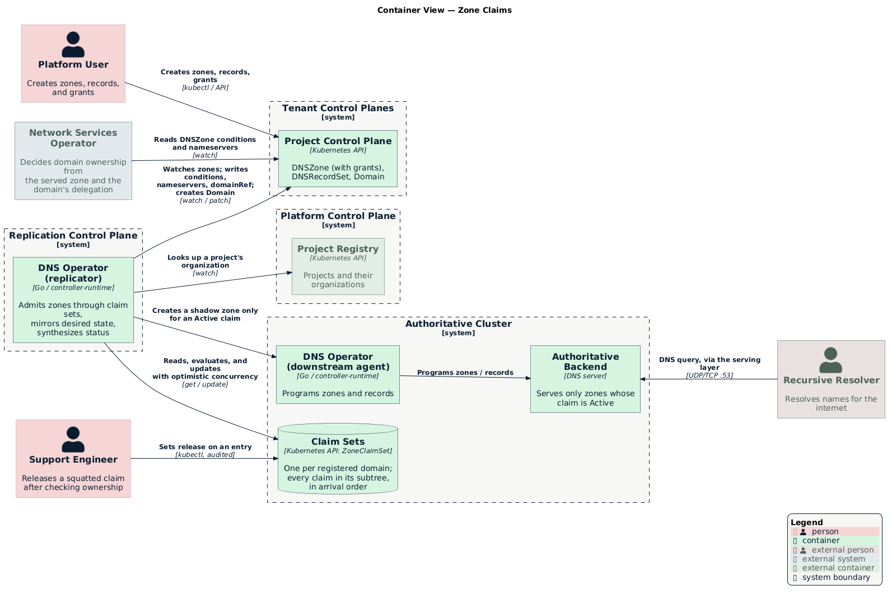
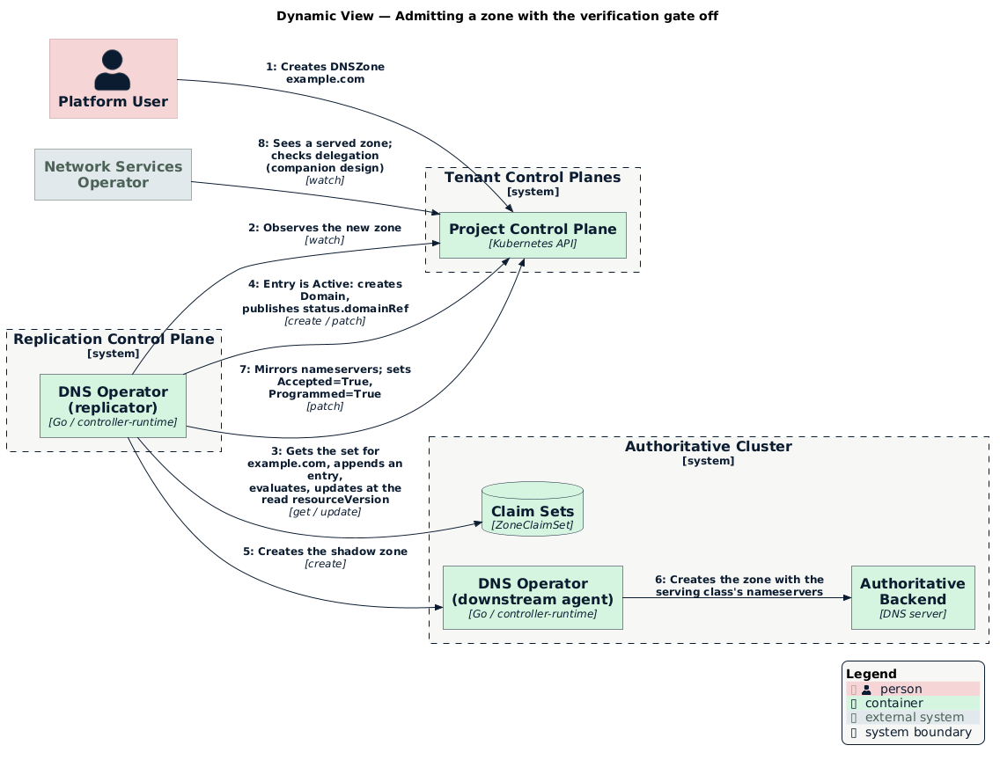

# Zone claims

- [Summary](#summary)
- [Container view](#container-view)
- [Claim sets](#claim-sets)
- [Evaluating a claim set](#evaluating-a-claim-set)
- [Admitting a zone](#admitting-a-zone)
- [The verification gate](#the-verification-gate)
- [Status on the zone](#status-on-the-zone)
- [Grants](#grants)
- [Reservations](#reservations)
- [Support release](#support-release)
- [Turning on claim sets](#turning-on-claim-sets)
- [Contract with network-services-operator](#contract-with-network-services-operator)
- [Configuration](#configuration)
- [Turning off the verification gate](#turning-off-the-verification-gate)
- [Testing](#testing)
- [Limitations](#limitations)

## Summary

A zone serves as soon as it's created, provided no other project claims its
name or any name above or below it. The DNS operator doesn't wait for the
zone's `Domain` to be verified. network-services-operator decides ownership
afterward, from the zone being served and the domain being delegated to the
zone's nameservers. See [Domain verification by delegation][nso-design].

A **claim set** records who may serve a name: one object per registered domain,
holding every project's claim in that domain's subtree, in arrival order.
Because a parent and its children share one object, a single
optimistic-concurrency update decides who's first, without a lock.

The rules claim sets enforce:

- A zone for a name under or over another project's zone never serves.
- One project can have zones at several levels of the same subtree.
- A project can grant a name in its subtree to another project, or hand over
  the whole name.
- A deleted zone's name stays reserved for its project for a fixed period.
- Support can release a claim with an audited action.
- The DNS operator never waits on a `Domain` verdict, so the two operators
  can't deadlock.

Each behavior is off until an environment turns on its setting, so a release
that contains it changes nothing on its own. See
[Configuration](#configuration).

## Container view

<p align="center">
  
</p>

The replicator is the only writer of claim sets. Claim sets live in the
authoritative cluster next to the shadow zones, where tenants have no access.
Tenants see the outcome only as conditions on their `DNSZone`.

## Claim sets

A `ZoneClaimSet` is a namespaced custom resource in the accounting namespace of
the authoritative cluster. Its name is the zone's **registered domain**, the
public suffix plus one label (`publicsuffix.EffectiveTLDPlusOne`), lowercased,
without a trailing dot. Every name in a subtree shares its registered domain,
so every claim that could conflict with another lives in the same object.

The resource is in `dns.networking.miloapis.com/v1alpha1`, but it's installed
only in the authoritative cluster and isn't part of the tenant API.

```yaml
apiVersion: dns.networking.miloapis.com/v1alpha1
kind: ZoneClaimSet
metadata:
  name: example.com
  namespace: datum-downstream-dnszone-accounting
spec:
  # Entries in arrival order. Order decides who's first.
  entries:
    - name: example.com
      project:
        name: acme-prod
        organization: acme
      zone:                       # empty while Reserved
        cluster: acme-prod        # multicluster cluster name, normalized
        namespace: default
        name: example-com
        uid: 4f0c...
      grants:                     # copied from the zone's spec.grants
        - name: dev.example.com
          project: acme-dev
      state: Active               # derived; rewritten on every update
      since: "2026-10-26T18:00:00Z"
    - name: dev.example.com
      project:
        name: acme-dev
        organization: acme
      zone:
        cluster: acme-dev
        namespace: default
        name: dev-example-com
        uid: 9a12...
      state: Active
      grantedBy: example.com
      since: "2026-10-26T18:05:00Z"
    - name: example.com
      project:
        name: squatter
        organization: other
      zone:
        cluster: squatter
        namespace: default
        name: mine
        uid: 77be...
      state: Contested
      reason: ClaimedByAnotherProject
      blockedBy: example.com
      since: "2026-10-26T18:10:00Z"
```

Entry fields:

| Field | Meaning |
|-------|---------|
| `name` | The zone name the entry claims, with its subtree. |
| `project` | The project that owns the entry, and its organization from the `Project`'s `spec.ownerRef`. |
| `zone` | The zone bound to the entry. Empty while `Reserved`. |
| `grants` | Names in the subtree this entry grants to other projects. |
| `grantedBy` | Set when the entry is `Active` only because of an ancestor's grant. |
| `state` | `Active`, `Reserved`, or `Contested`. Derived by [evaluation](#evaluating-a-claim-set). |
| `reason`, `blockedBy` | Why a `Contested` entry is blocked, and the name of the entry blocking it. |
| `reservedUntil` | When a `Reserved` entry expires. |
| `preexistingOverlap` | Set on entries imported from ConfigMaps that already overlapped another project's entry. Kept for as long as the entry exists, including while it's `Reserved`. See [Turning on claim sets](#turning-on-claim-sets). |
| `operatorSeeded` | An entry no zone can bind, used to keep a name out of reach. |
| `release` | A request from support to release the entry. Consumed by [normalization](#evaluating-a-claim-set). |
| `lastRelease` | Who released the entry, why, and when. Kept for audit. |
| `handedOverTo` | Set on a grantor's entry once its handover is applied. See [Grants](#grants). |
| `since` | When the entry arrived, or last changed state. |

A set holds at most `zoneClaims.maxEntries` entries. A zone that would exceed
the cap isn't recorded; it reports `Accepted=False` with reason `ClaimSetFull`
and retries on a timer.

### Why one object per registered domain

Kubernetes has no multi-object transactions. A claim per name can make the
exact-name check atomic with `Create`, but a parent and a child created at the
same moment each check for the other before either exists, and both win.
Putting the subtree in one object turns "first write wins" into an ordinary
resourceVersion conflict: two replicator workers that update the same set
concurrently can't both succeed, and the loser re-reads and re-evaluates.

A subtree can't span registered domains, so the set is the smallest object that
contains every possible conflict. A zone for a public suffix itself, such as
`co.uk`, has no registered domain and is refused with reason `InvalidDomain`.

## Evaluating a claim set

Two pure functions run, in order, before every write. Every worker that reads
the same entries derives the same result.

**`normalize(entries)`** applies the changes that move entries:

1. Drop expired `Reserved` entries.
2. Move each entry with a `release` to the end of the list, and move `release`
   to `lastRelease`. See [Support release](#support-release).
3. Apply each pending handover. See [Grants](#grants).

**`evaluate(entries)`** derives `state`, `reason`, `blockedBy`, and
`grantedBy`, and never reorders. Two entries **overlap** if their names are
equal or one is a descendant of the other (`domainCovers`). Walk the entries in
order and keep a list of blockers:

1. An entry with `handedOverTo` is `Contested` with reason `HandedOver`, and
   doesn't join the blockers.
2. For each other entry `e`:
   1. If an earlier `Active` entry from the same project has the same name,
      `e` is `Contested` with reason `DuplicateZoneInProject`.
   2. Otherwise, find the earliest blocker `b` that overlaps `e`, belongs to a
      different project, and doesn't permit `e` through a grant. If both have
      `preexistingOverlap`, they don't block each other.
   3. If there's a `b`, `e` is `Contested`, with `blockedBy: b.name` and reason
      `ClaimedByAnotherProject`, `ParentClaimedByAnotherProject`, or
      `ChildClaimedByAnotherProject`.
   4. Otherwise, `e` is `Active`, or `Reserved` if it has no zone, and joins the
      blockers. `operatorSeeded` entries always join the blockers.

A grant on blocker `b` permits `e` when `e.project` is the grantee and `e.name`
equals or is under the granted name.

Consequences:

- **First come, first served.** New entries append, so an `Active` entry is
  never demoted by a later arrival. Only a grant revocation, a handover, a
  release, or the blocker's own removal changes an existing entry's state.
- **The queue is fair.** When a blocker goes away, the earliest waiting
  `Contested` entry becomes `Active` on the next evaluation.
- **Same project, many levels.** A project can have zones for `example.com` and
  `shop.example.com` at once; both are `Active`.
- **Claims hold while the gate is on.** An `Active` entry blocks overlapping
  entries even while the [verification gate](#the-verification-gate) holds its
  zone back. Evaluation never reads a `Domain`, so the outcome is the same with
  the gate on or off, and turning the gate off never demotes a zone.

## Admitting a zone

<p align="center">
  
</p>

With `zoneClaims.enabled` on, the replicator's `DNSZone` reconcile admits a zone
in `ensureZoneClaim`:

1. Compute the registered domain. If there's none, refuse with `InvalidDomain`.
2. Get the claim set with the uncached reader. If it doesn't exist, build it
   from any accounting ConfigMaps for that registered domain (see
   [Turning on claim sets](#turning-on-claim-sets)) and create it.
3. Find the zone's entry by zone UID. If there isn't one, bind the zone to this
   project's `Reserved` entry for the same name, if there is one. Otherwise,
   append a new entry.
4. Copy the zone's `spec.grants` to its entry, skipping a self-grant on an
   entry with `handedOverTo`.
5. Run `normalize` and `evaluate`, and update the set with the resourceVersion
   you read. On a conflict, go back to step 2.
6. Act on the entry's state:
   - `Active`: continue to `ensureDomain`, `ensureDomainRef`, and the
     verification gate if it's enabled. Before `ensureDownstreamZone`, check
     that no other shadow zone for the same `spec.domainName` exists in the
     authoritative cluster. If one does, report `Accepted=False` with reason
     `PendingPreviousZoneRemoval` and wait for its deletion event.
   - `Contested`: delete the shadow zone if one exists, set `Accepted=False`
     and `Programmed=False`, and stop.

The backend identifies a zone only by name: `EnsureZone` does nothing if the
name exists, and deleting a shadow deletes the backend zone by name. The
shadow check in step 6 keeps a name from changing hands while the old shadow
still exists. Without it, after a handover or a release, the new zone's shadow
could adopt the old backend zone, or lose it when the old shadow is deleted.
The check uses a field index on shadow zones by `spec.domainName`.

On zone deletion:

- An `Active` entry becomes `Reserved` once the shadow zone is gone.
- A `Contested` entry is removed, so a waiting zone can't hold a place in the
  queue after it's gone.

A **claim-set controller** in the replicator watches `ZoneClaimSet` objects in
the authoritative cluster. On any change it enqueues every zone bound in the
set, so a waiting zone is admitted as soon as its blocker goes away. It also
requeues each set at its earliest `reservedUntil` to expire reservations.

A `Contested` entry has no shadow zone. When a zone that was serving becomes
`Contested`, after a handover or a release, its shadow is deleted. Its records
stay upstream, so its project can still export them. The record set replicator
mirrors record sets only for a zone that's `Accepted=True`, so a contested
project's records never reach the backend zone that another project serves.

## The verification gate

`controllers.dnsZoneReplicator.requireDomainVerification` controls whether an
`Active` zone also waits for its domain to be verified:

- `true` (default): an `Active` zone waits for `isDomainVerified` and is marked
  `PendingDomainVerification` until a covering `Domain` is `Verified`.
- `false`: the replicator skips `isDomainVerified` and
  `markPendingDomainVerification`. An `Active` zone is provisioned
  immediately, and its shadow zone is annotated
  `dns.networking.miloapis.com/served-before-verification: "true"`.

With the gate on, an unverified zone whose shadow carries the annotation loses
its shadow, so turning the gate back on stops the zones that were served while
it was off. A shadow without the annotation is left alone, which keeps zones
that were served before the gate existed serving.

The operator refuses to start with `requireDomainVerification: false` while
`zoneClaims.enabled` is `false`. Serving before verification is safe only while
claim sets refuse zones that overlap another project's.

The replicator creates the `Domain` and publishes `status.domainRef` in both
modes, so network-services-operator can find the zone.

Every `Active` zone that's provisioned publishes the serving class's
nameservers through `updateStatus`, mirrored from its shadow zone. The
project-side `DNSZoneClass` needs no nameserver policy.

With the gate off, the claim set alone decides whether a zone serves. Nothing
else holds a zone back.

## Status on the zone

Tenants see claims only through `DNSZone` conditions. `Accepted=True` means the
zone's entry is `Active` and nothing else holds it back. A `Contested` zone
reports `Accepted=False` and `Programmed=False` with reason `DNSZoneInUse`. The
message says which case applies:

| Entry reason | Message |
|--------------|---------|
| `ClaimedByAnotherProject` | `example.com is claimed by another project.` |
| `ParentClaimedByAnotherProject` | `example.com, a parent of shop.example.com, is claimed by another project. That project can grant shop.example.com to this one.` |
| `ChildClaimedByAnotherProject` | `shop.example.com, under example.com, is claimed by another project.` |
| `DuplicateZoneInProject` | `Zone default/example-com in this project already serves example.com.` |
| `HandedOver` | `example.com was handed over to project acme-new.` |

The message names the other project only when it's in the same organization.
Otherwise it says "another project", so a refusal doesn't reveal who uses a
domain.

Other `Accepted=False` reasons from admission:

| Reason | Meaning |
|--------|---------|
| `InvalidDomain` | The zone's name is a public suffix and has no registered domain. |
| `ClaimSetFull` | The registered domain's claim set is at `zoneClaims.maxEntries`. |
| `PendingPreviousZoneRemoval` | The zone's entry is `Active`, and the previous zone's shadow for the name is still being removed. |
| `PendingDomainVerification` | The gate is on and no covering `Domain` is `Verified`. |

## Grants

With `grants.enabled` on, a grant lets the project with a claim give part of its
subtree to another project. It's a field on the granting zone, so it uses the
zone's RBAC and lifecycle:

```yaml
apiVersion: dns.networking.miloapis.com/v1alpha1
kind: DNSZone
metadata:
  name: example-com
spec:
  domainName: example.com
  grants:
    - domainName: dev.example.com   # must equal or be under spec.domainName
      project: acme-dev
```

- **A child grant.** The grantee's zone for `dev.example.com`, or for any name
  under it, is `Active` with `grantedBy: example.com`. Removing the grant makes
  that zone `Contested` again.
- **A handover.** A grant whose `domainName` equals the zone's own name hands
  over the whole claim. Once the grantee's zone has an entry for the same name,
  `normalize`:
  1. Moves the grantee's entry into the grantor's position.
  2. Copies the grantor's grants to other projects onto the grantee's entry, so
     third-party child zones keep serving.
  3. Adds a grant on the grantee's entry for each of the grantor project's own
     entries under the name, so the grantor's other zones in the subtree keep
     serving until the grantee removes those grants.
  4. Sets `handedOverTo` on the grantor's entry and moves it to the end.

  The grantee's claim doesn't depend on the grantor, so deleting the old zone
  doesn't undo the move. The operator never edits the grantor's
  `spec.grants`. A self-grant on an entry with `handedOverTo` is ignored.
- **A reserved grantor.** A `Reserved` entry keeps its grants, so deleting the
  parent zone doesn't take away a child grant.
- A grant only takes effect while the granting entry is `Active` or `Reserved`.
  A CEL rule on `DNSZone` rejects a `domainName` outside the zone's subtree.
- With `grants.enabled` off, the replicator ignores grants and handovers, and a
  zone that has grants reports in its status that they're turned off.

## Reservations

When `zoneClaims.reservationPeriod` is positive and the zone bound to an
`Active` entry is deleted, the entry keeps its position, loses its `zone`, and
becomes `Reserved` with `reservedUntil = now + reservationPeriod`. A zone from
the same project for the same name, under any object name or namespace, binds
the entry and is `Active` again. A zone from another project is `Contested`
until the reservation expires.

With `reservationPeriod` at `0`, a deleted zone's entry is removed, as a
`Contested` entry is.

## Support release

Support releases a claim by setting `release` on the entry:

```yaml
release:
  by: support@example.com
  reason: "Ticket 1234: ownership verified out of band"
  at: "2026-10-26T19:00:00Z"
```

`normalize` moves the released entry to the end of the set and records
`lastRelease`. The zone that was waiting behind it is admitted, and the
released zone, if it still exists, is `Contested` and waits in line like any
new arrival. The claim-set controller enqueues both zones because both are
still bound in the set. The authoritative cluster's audit log records who made
the change. A runbook in [`docs/troubleshooting`](../../troubleshooting) covers
how to find the set and which entry to release.

## Turning on claim sets

With `zoneClaims.enabled` off, the replicator admits zones by exact name:
`ensureZoneAccounting` records each admitted zone in one ConfigMap per exact zone
name in the accounting namespace, with `owner: <cluster>/<namespace>/<zone>`.

With the setting on, the replicator builds claim sets from those ConfigMaps
lazily. When `ensureZoneClaim` finds no claim set for a registered domain, it
lists the accounting ConfigMaps whose names are that domain or under it and
builds the set from them:

- Entries are ordered by ConfigMap `creationTimestamp`, then by name.
- An `owner` that parses as `<cluster>/<namespace>/<zone>` becomes an entry for
  that zone, after the same cluster-name normalization `sameZoneOwner` applies.
  The project and organization are looked up from the cluster.
- An `owner` that doesn't parse is an operator-seeded claim and becomes an
  `operatorSeeded` entry.
- Imported entries from different projects that overlap are all marked
  `preexistingOverlap`, so a parent and a child that both serve before claim
  sets are turned on keep serving. A metric counts these entries for review. An
  entry keeps `preexistingOverlap` for as long as it exists, including while
  it's `Reserved`, so deleting one of the zones never stops the other.

While the setting is on, the replicator keeps writing the exact-name ConfigMap
for each admitted zone and deletes it with the zone. Turning the setting off
returns to exact-name admission, with a ConfigMap for every zone admitted in the
meantime. A zone that claim sets refused because it's under or over another
project's zone is admitted by exact name again, and with the verification gate
on it serves only once its domain is verified.

## Contract with network-services-operator

network-services-operator decides ownership. It reads, from the tenant's
`DNSZone`:

- `Accepted=True` and `Programmed=True`, meaning the zone's claim is `Active`
  and the zone is served.
- `status.nameservers`, the serving class's nameservers.
- `status.domainRef.name`, the `Domain` the zone belongs to.

The DNS operator guarantees:

- `Accepted=True` is never set on a zone whose entry isn't `Active`.
- A zone whose entry stops being `Active` loses `Accepted=True` and its shadow
  zone in the same reconcile.
- Tenants can't write `DNSZone` status. The IAM roles in
  [`config/iam/roles`](../../../config/iam/roles) grant `dnszones/status.get`
  only. The ownership verdict depends on this staying true.

With the gate off, the DNS operator reads only `Domain.status.nameservers`,
which it mirrors into `status.domainRef` for display. It never reads a `Domain`
condition, so neither operator waits on the other.

## Configuration

Fields on the `DNSOperator` server config. Every default keeps the behavior from
before claim sets, so each behavior stays off until an environment turns on its
setting.

| Field | Default | Description |
|-------|---------|-------------|
| `controllers.dnsZoneReplicator.zoneClaims.enabled` | `false` | Admit zones through claim sets. Off: admit by exact name with accounting ConfigMaps. |
| `controllers.dnsZoneReplicator.zoneClaims.reservationPeriod` | `0` | How long a deleted zone's name stays reserved for its project. `0` turns reservations off. |
| `controllers.dnsZoneReplicator.zoneClaims.maxEntries` | `256` | The most entries one claim set holds. |
| `controllers.dnsZoneReplicator.grants.enabled` | `false` | Honor grants and handovers in `spec.grants`. |
| `controllers.dnsZoneReplicator.requireDomainVerification` | `true` | Wait for a verified `Domain` before serving an `Active` zone. The operator refuses to start with `false` while `zoneClaims.enabled` is `false`. |

An environment turns the settings on in this order:

1. `zoneClaims.enabled`.
2. `zoneClaims.reservationPeriod` and `grants.enabled`.
3. `requireDomainVerification: false`, following
   [Turning off the verification gate](#turning-off-the-verification-gate).

## Turning off the verification gate

1. Check that `zoneClaims.enabled` is on, that no zone reports `ClaimSetFull`,
   and review the entries marked `preexistingOverlap`.
2. List every zone with reason `PendingDomainVerification`. Each one serves,
   and its entry is already `Active`, when the gate goes off.
3. Review first the zones whose domain is already delegated to the platform.
   They answer for that domain as soon as the gate goes off, and whoever owns
   the zone is verified by delegation.
4. Set `requireDomainVerification: false`.

To roll back, set it to `true`. Zones served while the gate was off and still
unverified stop serving. Claim sets are valid in both modes. To turn claim sets
off as well, turn the gate back on first.

## Testing

Unit tests cover `normalize` and `evaluate` as tables: arrival order, exact and
subtree overlap, same-project nesting, duplicates in a project, grants and
their removal, a handover carrying third-party grants and the grantor's own
child zones, reservation and expiry, release, `preexistingOverlap` through a
reservation, and operator-seeded entries. An envtest case runs two workers that
admit a parent and a child at the same moment and asserts exactly one is
`Active`.

The end-to-end suite runs in the `milo` discovery topology
([`config/dependencies/milo`](../../../config/dependencies/milo)) so it has two
project control planes, with network-services-operator deployed
(`NSO_DEPLOY=true`). Its server config turns on `zoneClaims.enabled`, a short
`zoneClaims.reservationPeriod`, and `grants.enabled`. Cases set
`requireDomainVerification` themselves. Every case asserts what the
authoritative server answers, not only what a condition says.

| Case | Must observe |
|------|--------------|
| Gate on refuses | With `requireDomainVerification: true`, an unverified zone isn't answered. |
| Gate needs claims | The operator refuses to start with `requireDomainVerification: false` and `zoneClaims.enabled: false`. |
| Gate back on | A zone served with the gate off, still unverified, stops answering when the gate is turned back on. A zone with no annotation keeps answering. |
| Gate off serves | With the gate off, a new zone's SOA is answered before its `Domain` is verified. |
| Same name, second project | The second zone is `Contested`. Queries are answered from the first project's records only. |
| Child, second project | A second project's zone for `shop.example.com` is `Contested`, and `shop.example.com` is answered from the parent zone. |
| Parent, second project | A second project's zone for the parent of an `Active` zone is `Contested` and isn't answered. |
| Same project nesting | Zones for `example.com` and `shop.example.com` in one project are both answered. |
| Queue | Deleting the incumbent, after its reservation expires, admits the waiting zone and it's answered. |
| Reservation | A zone deleted with the gate off stops answering. A second project's zone for the name is `Contested`. The same project recreates it under another object name, and it's answered. |
| Grant | A second project's child zone is `Contested`, is answered after the grant, and stops answering when the grant is removed. |
| Handover | After a handover, the new project's zone is answered and the old one isn't. |
| Release | After support releases a squatter's entry, the waiting zone is answered and the squatter's isn't. |
| Import | Accounting ConfigMaps produce a claim set with the same owners, and every zone that was answered still is. |
| Tenant can't write status | A tenant role's patch of `dnszones/status` is refused. |

The verification cases across both operators are described in
[Domain verification by delegation][nso-design].

## Limitations

| Limitation | Effect |
|------------|--------|
| A dangling delegation: a domain delegated to the platform with no zone goes to whoever creates the zone first. | Reservations cover the case where a zone existed. network-services-operator flags a zone whose domain was delegated before it existed. |
| A squatter's claim blocks the rightful owner. | Support releases it. There's no self-service contest. |
| A reservation lasts a fixed period. | It doesn't follow whether the domain is still delegated to the platform. |
| A public suffix list update can move a registered domain boundary, so new zones look up a different set. | The list changes only with a dependency update. Check the diff of suffixes against existing claim sets before you upgrade. |
| A busy registered domain causes update conflicts. | Conflicts retry. Sets are small and writes happen only on zone changes. |

[nso-design]: https://github.com/datum-cloud/network-services-operator/blob/main/docs/architecture/domain-verification-by-delegation.md
